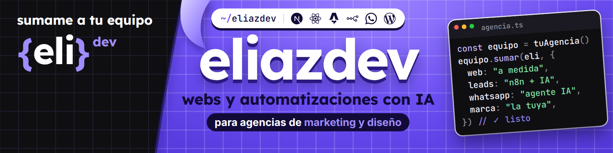
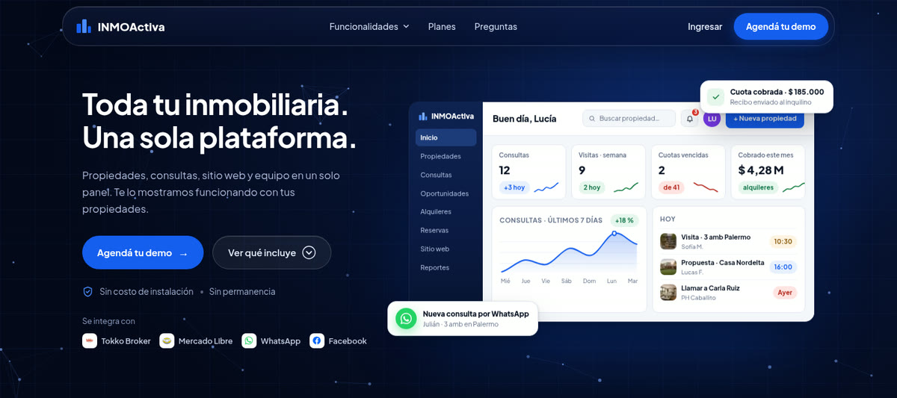
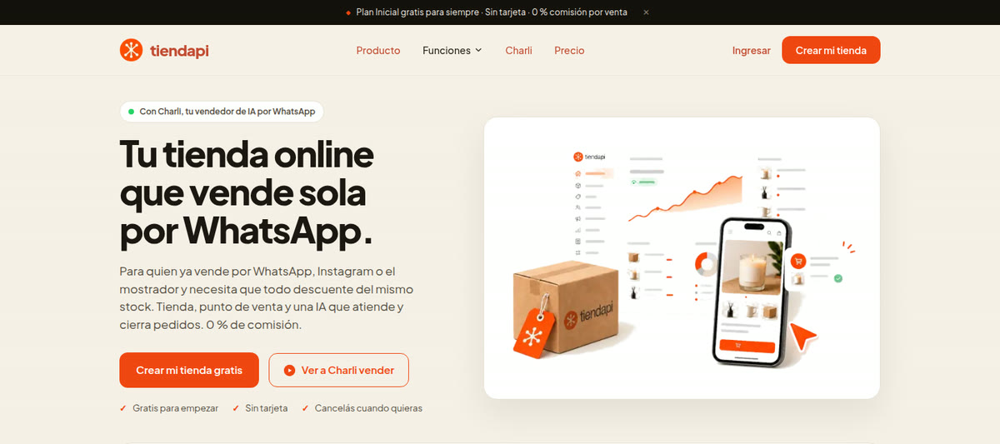

  

<h3 align="center">Hola, soy Eli 👋 Desarrolladora full stack y fundadora de Inmoactiva y Tiendapi</h3>

  Creo productos completos, del modelo de datos al deploy: plataformas SaaS, sistemas de gestión, tiendas online y agentes de IA que atienden por WhatsApp. 
  Full-stack developer and founder · SaaS, management systems, e-commerce and AI agents · remote from Argentina (UTC−3)

  
  
  

---

### 🧪 Productos listos para adaptar

Siete sistemas que diseñé y armé como demo navegable. Cada uno se lleva a la marca y al negocio de tu cliente.

  
  

<table>
<tr>
<td colspan="2" width="100%" valign="top">
 
<b><a href="https://orbitalnestdev.github.io/saas-concepts/turnly.html">Turnly</a></b> · app de turnos para el celular 
El cliente reserva servicio, profesional y horario, deja una seña y recibe recordatorios por WhatsApp. El negocio ve la agenda, la ocupación y los ingresos del día. 
<code>React Native</code> <code>Expo</code> <code>Supabase</code>
</td>
</tr>
<tr>
<td width="50%" valign="top">
 
<b><a href="https://orbitalnestdev.github.io/saas-concepts/leadnest.html">Leadnest</a></b> · CRM con WhatsApp e IA 
Pipeline con el canal y un puntaje de IA en cada oportunidad, y el resumen de cada conversación con la intención y el próximo paso. 
<code>Next.js</code> <code>PostgreSQL</code> <code>OpenAI</code>
</td>
<td width="50%" valign="top">
 
<b><a href="https://orbitalnestdev.github.io/saas-concepts/replyo.html">Replyo</a></b> · inbox de WhatsApp con agentes de IA 
La IA responde con la información del negocio, agenda turnos y pasa la charla a una persona con todo el contexto. 
<code>Next.js</code> <code>n8n</code> <code>WhatsApp Cloud API</code>
</td>
</tr>
<tr>
<td width="50%" valign="top">
 
<b><a href="https://orbitalnestdev.github.io/saas-concepts/marginly.html">Marginly</a></b> · ganancia real de una tienda online 
Costo, envío, comisiones y publicidad producto por producto, con ideas de la IA y su impacto estimado. 
<code>Next.js</code> <code>Shopify API</code> <code>Meta Ads</code>
</td>
<td width="50%" valign="top">
 
<b><a href="https://orbitalnestdev.github.io/saas-concepts/kinetik.html">Kinetik</a></b> · gestión para gimnasios 
Socios, clases con cupo, pagos y la lista de quienes dejaron de venir, con recordatorio por WhatsApp en un clic. 
<code>Next.js</code> <code>Prisma</code> <code>Stripe</code>
</td>
</tr>
<tr>
<td width="50%" valign="top">
 
<b><a href="https://orbitalnestdev.github.io/saas-concepts/bulkly.html">Bulkly</a></b> · pedidos mayoristas B2B 
Pedido rápido por SKU con la lista de precios de cada cliente, mínimos por bulto y stock por depósito. 
<code>Next.js</code> <code>Node.js</code> <code>PostgreSQL</code>
</td>
<td width="50%" valign="top">
 
<b><a href="https://orbitalnestdev.github.io/saas-concepts/nutrio.html">Nutrio</a></b> · panel para nutricionistas 
Evolución de cada paciente, macros del día, plan semanal armado con IA y registro de comidas por foto. 
<code>Next.js</code> <code>Supabase</code> <code>OpenAI</code>
</td>
</tr>
</table>

Las demos usan marcas y datos de ejemplo, en inglés.

---

### 🚀 Productos que fundé

<table>
<tr>
<td width="50%" valign="top">
 
<b>Inmoactiva</b> · SaaS para inmobiliarias 
Toda la inmobiliaria en un panel: propiedades, consultas, alquileres con cobro de cuotas, reservas y equipo, más un sitio web con dominio propio para cada inmobiliaria. Se integra con Tokko Broker, Mercado Libre, WhatsApp y Facebook, y suma un agente de IA que responde consultas. 
<code>Next.js</code> <code>Appwrite</code> <code>n8n</code> <code>WhatsApp API</code> <code>Mercado Pago</code> <code>multi-tenant</code>
</td>
<td width="50%" valign="top">
 
<b><a href="https://tiendapi.com">Tiendapi</a></b> · tiendas online que venden por WhatsApp 
Tienda, punto de venta y un vendedor con IA que atiende y cierra pedidos por WhatsApp, todo sobre el mismo stock. Carga por planillas, venta a granel, precios en varias monedas, preventa, cupones y permisos por rol. 
<code>Next.js</code> <code>Appwrite</code> <code>WhatsApp</code> <code>IA</code> <code>multi-tenant</code>
</td>
</tr>
</table>

### 🧩 Sistemas a medida

| | |
|---|---|
| 🏋️ **Sistema para un gimnasio** Web y panel propio: horarios, planes con cupos por disciplina, suscripciones, asistencia, reseñas y clases grabadas para socios. Resolví una auditoría de usabilidad de 22 puntos y la home bajó de 90 KB a 18 KB. `Next.js` `Appwrite` `Mercado Pago` | 🔥 **Landing con mapas de calor** Con un sistema de seguimiento de conversiones: de dónde llega cada visita, qué hace en la página y cuándo se convierte en consulta. |
| 📦 **Sistema de stock** Productos, movimientos de entrada y salida y existencias al día. | 📋 **App de seguimiento de inventario** Qué hay, dónde está y qué se movió, en una sola app. |
| 🏬 **Ecommerce mayorista (B2B)** Listas de precios, cuenta corriente, presupuestos, pedidos y stock, instalable en cualquier hosting compartido. `PHP` `MySQL` `Astro` | 🎯 **Prospección automatizada** Busca negocios en Google Maps, puntúa cada lead según el rubro y envía mails personalizados con topes diarios y lista de exclusión. `Next.js` `SQLite` `Apify` |

### 🤖 IA y automatización

- **Agente de IA en WhatsApp** para un desarrollo inmobiliario: embudo de 7 etapas que califica y deriva a quien vende, sin inventar precios.
- **CRM sobre WhatsApp con agentes de IA**: embudos por etapas y agentes que responden, califican y pasan la consulta.
- **Flujos con n8n y Zapier**: los leads de Meta llegan solos a planillas y CRM, y las ventas vuelven a Meta como conversiones.
- **Medición que cierra**: corregí una tienda que le pasaba a Meta pesos como si fueran dólares y dejé en regla 936 productos para Google Merchant Center.
- **Segundo cerebro para agentes de IA**: memoria compartida en Obsidian para Claude Code y Codex, con registro automático de sesiones, resumen diario y pendientes.
- **Contenido con código**: carruseles, portadas y videos para LinkedIn generados con React y Remotion.

### 💼 Experiencia

| Desde | Rol |
|---|---|
| oct. 2026 | Fundadora · **Tiendapi** |
| oct. 2026 | Desarrollo web white label · **2Factor** |
| ago. 2026 | Fundadora · **Inmoactiva** |
| ene. 2022 | Web Development Team Lead · **Adamas** |
| 2015 | Desarrolladora web freelance: webs, tiendas online, SEO técnico y medición |

### 🛠️ Stack

  
  
  
  
  
  
  
  
  
  
  
  
  
  
  
  
  
  
  
  
  
  
  
  

### 🤝 ¿Tu agencia o tu empresa necesita una mano técnica?

Me sumo a tu equipo y me ocupo de la parte técnica de punta a punta: presupuesto cerrado por proyecto o paquete de horas, entrega con documentación y accesos a tu nombre.
Escribime por [LinkedIn](https://www.linkedin.com/in/eliazdev) o contratame en [Fiverr](https://www.fiverr.com/elyazcurra90).

{eli}dev · La Rioja, Argentina · trabajo en remoto

